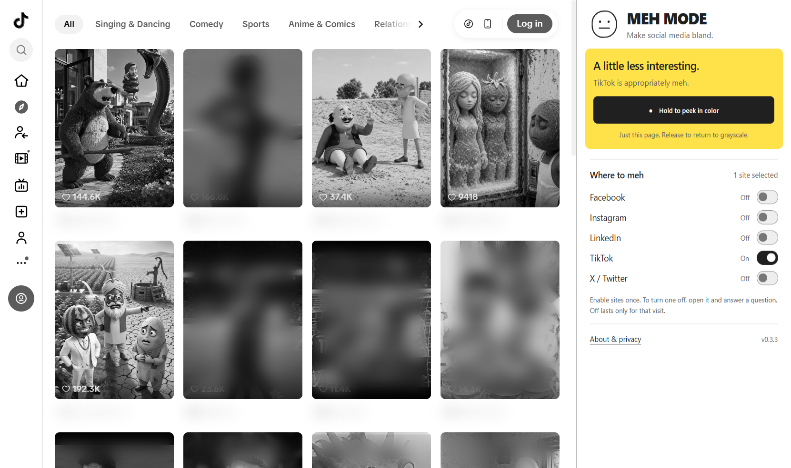
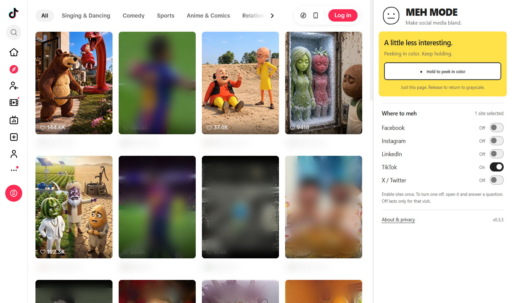
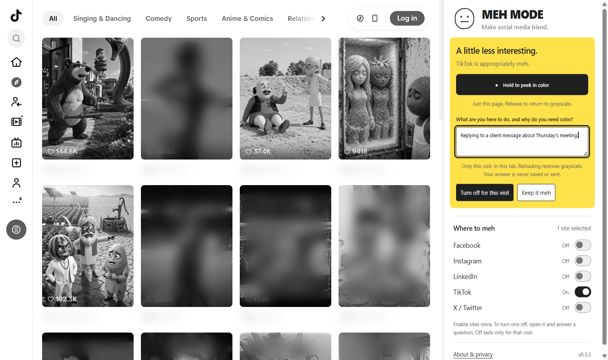
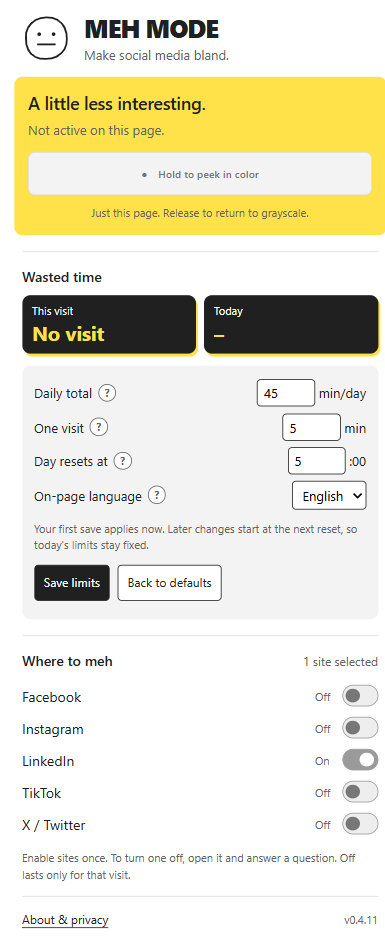
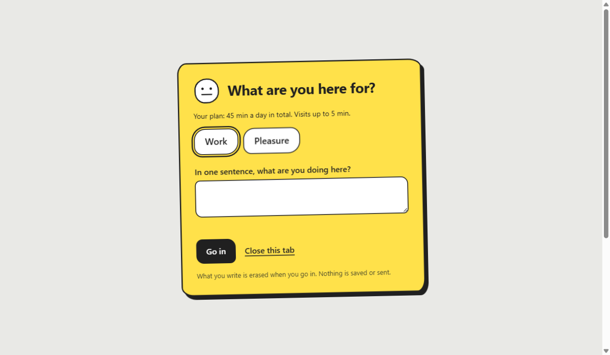
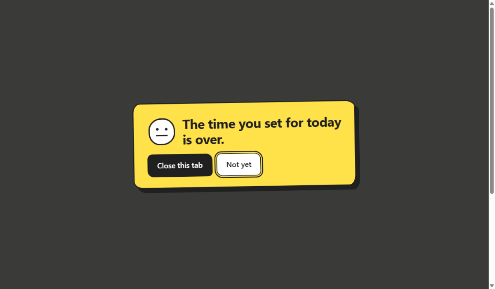

<h1 align="center">MEH MODE</h1>

<b>Make social media bland.</b> A free Chrome extension that turns social media gray, asks why you came, and nags you when your time is up.

<a href="https://github.com/Aha85/meh2/raw/main/download/meh-mode.zip"><b>⬇ Download MEH MODE</b></a>

## Why

You open LinkedIn to answer one message. Twenty minutes later you're still scrolling.

Feeds are built to be bright: red badges, colorful thumbnails, flashy promos. MEH MODE takes the color away on the sites you choose. Everything still works. You can still read, write, search and reply. It's just a little less interesting.

## What it does

- **Grayscale on the sites you pick.** Facebook, Instagram, LinkedIn, TikTok and X / Twitter. All start off. You choose.
- **Hold to peek in color.** Need to check a photo or a chart? Hold the button. Color lasts only while you hold it.
- **Questions at the door.** Each visit starts with what you're here for and one sentence about it. Past 50% and 80% of your daily time, there are more questions. Past 80% there is also a one-minute wait.
- **A daily limit and a visit limit.** You set both. Defaults: 45 minutes a day, 5 minutes a visit.
- **Nudges when time is up.** A popup jumps up, then keeps coming back more often. You can always close it. Nothing is blocked.
- **Turning it off takes a sentence.** To switch a site off, you write why you need color. It stays off for that visit only. Next time, it's gray again.

## The settings panel

Click the MEH MODE icon to open the panel.

- **Daily total:** minutes a day across all your sites.
- **One visit:** minutes before the nudges start.
- **Day resets at:** the hour your daily time starts over.
- **On-page language:** English or Hebrew, for the questions and nudges.
- **Save limits:** your first save applies now. Later changes start at the next reset, so today's limits stay fixed.
- **Where to meh:** switch on the sites you want.

## What it's based on

Short studies on grayscale phones motivated this experiment:

- In a one-week study, 84 Android users spent about 20 fewer minutes a day on their phones in grayscale. They unlocked their phones just as often. ([Dekker and Baumgartner, 2024](https://doi.org/10.1177/20501579231212062))
- A small feasibility trial with medical students reported about 28 fewer minutes a day, with some usability complaints. ([Hagerty et al., 2026](https://doi.org/10.3389/fdgth.2026.1816095))
- Adding a short moment of friction before opening an app reduced how often people opened it. ([Grüning et al., PNAS 2023](https://doi.org/10.1073/pnas.2213114120))

**Honest limits:** these studies looked at phones, not desktop social media, and at different kinds of friction. MEH MODE itself has not been tested in a study, and neither have its limits or nudges. It does not "reset your dopamine" or cure anything. It's a simple tool worth trying.

## Install (about 2 minutes)

MEH MODE is not in the Chrome Web Store yet, so you install it manually:

1. **[Download meh-mode.zip](https://github.com/Aha85/meh2/raw/main/download/meh-mode.zip)** and unzip it. Keep the folder somewhere permanent, like Documents.
2. In Chrome, go to `chrome://extensions`.
3. Turn on **Developer mode** (top right).
4. Click **Load unpacked** and choose the unzipped **`extension`** folder (the one with `manifest.json` inside).
5. Click the puzzle icon in the toolbar and **pin** MEH MODE.
6. Open a social site, click the MEH MODE icon, and switch that site **On**. Approve Chrome's access request.
7. Set your limits in the panel and click **Save limits**, or keep the defaults.
8. Reload the site. The first question appears.

Tip: the panel opens on the side of the page. To move it right, go to Chrome **Settings → Appearance → Side panel → Show on right**.

Works in Chrome 120+ and other Chromium browsers on desktop.

## Privacy

- No account, no tracking, no analytics, no servers.
- Site access is used only to add or remove grayscale. Page content is never read, saved or sent.
- Your written answers are never saved or sent.
- Only your site choices, your limits and today's minutes used are stored, locally in your browser.
- What you type in the entry questions is erased when you go in.

## Remove

Go to `chrome://extensions` and click **Remove** on MEH MODE.

## About

Made by [Danny Shaket](https://www.dannyshaket.com/creations). Feedback and bug reports: [open an issue](https://github.com/Aha85/meh2/issues).

Released under the [MIT License](LICENSE).
